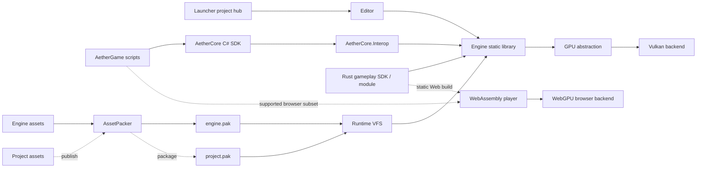

<p align="center">
  
</p>

<h1 align="center">AetherCore</h1>

<p align="center">
  <strong>A native 2D and 3D game engine with Vulkan rendering, C# and Rust gameplay, and self-contained WebGPU browser exports.</strong>
</p>

<p align="center">
  
  
  
  
  
  
</p>

<p align="center">
  <a href="#what-is-aethercore">What is it</a> ·
  <a href="#quick-start">Quick start</a> ·
  <a href="#editor-workflow">Editor workflow</a> ·
  <a href="#2d-workflow">2D workflow</a> ·
  <a href="#c-scripting">C# scripting</a> ·
  <a href="#rust-gameplay">Rust gameplay</a> ·
  <a href="#foxshowcase-and-browser-play">Browser play</a> ·
  <a href="#engine-mcp">Engine MCP</a> ·
  <a href="#architecture">Architecture</a> ·
  <a href="#asset-and-shipping-pipeline">Asset pipeline</a> ·
  <a href="docs/website.md">Website development</a>
</p>

<br>

## What is AetherCore?

AetherCore brings scene authoring, gameplay, materials, physics and rendering into one native workspace. Build with the dockable editor, inspect the systems behind a frame, and publish supported projects as desktop games or static browser players.

Screenshot spaces are reserved below while FoxShowcase’s grass and presentation are being updated. Fresh engine captures will arrive together in a separate image commit.

> **3D workspace capture pending**

### 3D editor

Dockable viewport, hierarchy and inspectors on the full native render graph: GPU-driven culling, tiled lighting, shadows and post-processing.
<br>
<br clear="all">

> **2D editor capture pending**

### 2D editor

The same shell in orthographic mode: sprite placement, non-destructive sheet slicing, and animation timelines with deterministic playback.

<br clear="all">
<br>

> **Material authoring capture pending**

### Material authoring

Work with connected material inputs, a live sphere preview and the scene viewport in the same editor. Supported material graphs are cooked for browser publishing.

<br clear="all">

## At a glance

| Area | Current capabilities |
|---|---|
| **Editor** | Standalone project Launcher, Night Amber ImGui workspace, dockable viewport and inspectors, scene hierarchy, project/file browser, UI canvas tools, theme editor, render-graph and texture inspection |
| **2D authoring** | Blank 2D projects, orthographic 2D viewport and XY tools, sprite placement and picking, non-destructive sheet slicing, sprite animation timelines, deterministic playback, and 2D asset publishing |
| **Rendering** | Bindless descriptors, buffer device address, render graph, GPU-driven draw culling, tiled lighting, directional and local shadows, GTAO, FXAA, tonemapping, post-processing, offscreen cameras |
| **Scene and simulation** | EnTT world, reflection-driven component editing and scene serialization, typed asset identities, Jolt 3D and Box2D 2D physics, skeletal animation, blending, root motion, day/night lighting |
| **Gameplay** | Public C# and Rust SDKs through a shared gameplay host; inspector-exposed C# fields, collectible assembly replacement outside Play, native interop and Visual Studio script debugging; Rust rebuild/relaunch |
| **Assets** | Virtual file system, glTF import, mesh and animation processing, texture transcoding, material presets and graph authoring, shared engine content, and target-qualified project packages |
| **Browser publishing** | Self-contained WebAssembly/WebGPU players for supported 2D and 3D profiles, cooked assets, packaged audio, browser saves, manifest integrity and explicit unsupported-content diagnostics |
| **Diagnostics** | Tracy CPU/GPU instrumentation, render-pass timings, resource inspection, validation logging, built-in editor-control MCP scene authoring, and Visual Studio debugger MCP workflow |

> [!NOTE]
> AetherCore is under active development. The editor, runtime, scripting API, and
> asset formats are usable today, but backward compatibility is not guaranteed yet.

## FoxShowcase and browser play

> **FoxShowcase gameplay capture pending**

FoxShowcase brings a 3D landscape, animated wildlife, physics, materials and interactive field notes together in one example project. Its current game package and screenshots remain local while the grass pass is in progress; this website commit does not include a playable download.

To explore the website locally, serve the repository:

```powershell
python -m http.server 8000 --bind 127.0.0.1
```

Open **http://127.0.0.1:8000/website/**. The showcase marks its browser build as pending instead of linking to an absent export.

The site and player are static files suitable for GitHub Pages; gameplay runs on the visitor’s device. **GitHub Pages deployment and live-host qualification are not yet confirmed.** Free hosting has size and bandwidth limits, not unlimited traffic. See [website setup, hosting requirements and capture provenance](docs/website.md).

Publish and qualify a fresh self-contained export before enabling browser play. The website’s responsive-layout checks are separate from gameplay verification.

Browser support is profile-based, not a promise of universal native parity. Both Rust and C# use the publisher, with a documented C# browser subset; unsupported content is rejected rather than silently removed. See [Web exports](docs/web-export.md), [C# browser support](docs/csharp-web.md) and the [effect parity ledger](docs/architecture/webgpu-effect-parity.md).

## Quick start

### Windows

Requirements:

- Visual Studio 2022 or newer with the Desktop development with C++ workload
- CMake 3.21+
- Vulkan SDK
- .NET 10 SDK for managed gameplay scripting

Configure and build the default MSVC development preset:

```powershell
cmake --preset default
cmake --build --preset default
```

This builds both the project hub and the editor. Start with the Launcher:

```text
build/default/src/app/RelWithDebInfo/Launcher.exe
```

For ClangCL:

```powershell
cmake --preset vs2022-clang
cmake --build --preset vs2022-clang
```

Open `managed/AetherCore.slnx` in **Visual Studio 2026** or Rider to edit the engine managed code (the `AetherCore` SDK and `AetherCore.Interop` boot assembly). A project's gameplay scripts live in `projects/<name>/scripts/` and are edited there. The `net10.0` projects do not load in VS 2022, but VS 2022 can still build the native C++ targets through CMake.

### Linux

The Linux preset uses Clang, Ninja, and `RelWithDebInfo`:

```bash
cmake --preset linux-clang
cmake --build --preset linux-clang
```

Requires the Vulkan loader and driver, Clang, Ninja, and GLFW's platform development packages. The .NET 10 SDK is optional-managed scripting is skipped when it is absent.

### Useful presets

| Preset | Purpose |
|---|---|
| `default` | VS 2022 MSVC development build (`RelWithDebInfo`) |
| `vs2022-clang` | VS 2022 generator with ClangCL |
| `clangd` | Ninja + clang-cl compilation database and clang-tidy target |
| `linux-clang` | Linux Ninja + Clang development build |
| `vs2022-msvc-release` | Ship configuration |
| `vs2022-msvc-retail` | Retail configuration with LTCG and stripped diagnostics |

## Editor workflow

1. Start `Launcher` and create or open a project; it spawns a dedicated `Editor` process and closes itself.
2. Build a scene with the hierarchy, inspector, viewport, asset browser, and component tools.
3. Author gameplay with the project's selected C# or Rust SDK under its `scripts/` directory.
4. Enter Play to run it. For C# assembly replacement, **Stop first**, then use **F5 / Reload Scripts** in a development build. Requests during Play are rejected; arbitrary live script state is not migrated. Rust uses rebuild/relaunch.
5. Use **Debug C#** in the Project panel to open scripts in Visual Studio with the debugger attached, or pack and publish a standalone build.
6. **File > Save & Return to Project Launcher…** saves and hands control back to the hub when switching projects.

Each project is rooted by `ProjectSettings.toml` and owns its assets, scenes, prefabs, scripts, build intermediates, and publish settings. Engine resources mount through `engine://`, project content through `project://`.

## 2D workflow

Choose **Blank 2D** in the Launcher for an orthographic camera, 2D viewport grid and XY tools, and sprite rendering. It is the same project structure and editor shell as 3D, so scenes still share assets, C# gameplay, UI, packaging, and the render graph.

1. Import a texture or sprite sheet, then open the **Sprite Slicer** to create and refine non-destructive regions with grid, trim, and pivot tools.
2. Drag sprites into the 2D viewport or create **Sprite** and **Animated Sprite** entities from the hierarchy.
3. Create animation clips in the **Sprite Animation** timeline, edit frame durations and events, then preview playback in Edit or Play mode.
4. Save, script, and publish normally. Sprite regions keep stable identities across compatible re-slices, and published projects package their sprites, atlases, animations, and scenes.

Physics2D (Box2D) and chunked tilemaps have both shipped, alongside sprite authoring, animation, parallax, particles and 2D lighting.

## C# scripting

Managed gameplay is split across three assemblies with a deliberate boundary:

| Assembly | Role |
|---|---|
| `AetherCore` | Public gameplay SDK: entities, world, input, camera, physics, logging, and components |
| `AetherCore.Interop` | ABI and CoreCLR boot layer used by the native host; hidden from normal game code |
| `AetherGame` | Project gameplay scripts loaded into a collectible context for hot reload |

Scripts derive from `EntityScript`. Public fields appear in the editor inspector and serialize with the entity:

```csharp
using System.Numerics;
using AetherCore;

namespace AetherGame;

public sealed class Spinner : EntityScript
{
    public float DegreesPerSecond = 90.0f;

    public override void OnUpdate(float deltaTime)
    {
        Vector3 euler = Self.EulerDegrees;
        euler.Y = (euler.Y + DegreesPerSecond * deltaTime) % 360.0f;
        Self.EulerDegrees = euler;
    }
}
```

The CMake build runs `dotnet build` when the .NET SDK is present and deploys the managed assemblies next to the native executable. NuGet dependencies declared by the game project resolve into the script load context.

For exact declarations, SDK boundaries and working C#/Rust examples, start with
[Script APIs and examples](docs/getting-started.md#script-apis-and-examples).
[Rust gameplay](docs/rust-gameplay.md) covers the safe Rust SDK, project creation,
rebuild/relaunch and publishing; Rust does not use C#'s F5 hot-reload path.

## Rust gameplay

Select Rust when creating a project. The safe SDK supplies `Script`, `Context`, registration macros and access to the shared gameplay host; desktop builds load the native module, while browser publishing links the selected game into the WebAssembly player. C# remains the default for projects without language metadata.

Rust currently uses **rebuild/relaunch**, not the C# assembly-replacement path. Start with [Rust gameplay](docs/rust-gameplay.md) and [paired SDK examples](docs/getting-started.md#script-apis-and-examples).

## Engine MCP

AetherCore ships its own MCP server, so a coding agent can run the test gauntlet,
inspect the Launcher hub, or drive a live editor-editing scenes, managing panels,
querying the render graph, capturing textures and screenshots, and entering play
mode. The live-control endpoint listens only on `127.0.0.1`.

```powershell
cmake --build --preset default --target Editor aether-ctl
./scripts/Install-Mcp.ps1 -Targets codex
```

The Launcher owns the control port while its hub is open (`8787` by default) and hands
it off to the Editor it launches, so MCP tools follow the handoff without reconfiguration.
For a directly started Editor, set `AETHER_CONTROL_PORT=8787` or enable the **Control Server**
panel. Without an editor, `gameplay_job_start/status/cancel` inspect, build, test and
publish Rust/C# projects through the existing gameplay pipeline. See the [MCP setup guide](docs/mcp-setup.md#aethercore-mcp) and the [full engine MCP reference](tools/mcp/README.md).

## Architecture



The frame pipeline follows an extract-and-consume model: the producer thread gathers render data into an immutable `RenderFramePacket`, then the render thread consumes that packet without reading mutable ECS state. See [Render-frame extraction](docs/architecture/render-frame-extraction.md).

### Main native areas

| Path | Responsibility |
|---|---|
| `src/engine/gpu/` | Engine-facing device, command, handle, format, and synchronization abstractions |
| `src/engine/vulkan/` | Vulkan implementation, resource registry, swapchain, memory, descriptors, and diagnostics |
| `src/engine/rendering/` | Render graph, frame packets, queues, render thread, shadows, and pipeline state |
| `src/engine/scene/` | ECS world, scene subsystem, serialization-facing components, and hierarchy |
| `src/engine/assets/` | Asset database, glTF ingestion, model/texture creation, and upload services |
| `src/engine/material/` | Material authoring, registries, texture lifetime, and GPU material data |
| `src/engine/animation/` | Skeletons, clips, animation database, blending, and GPU skinning data |
| `src/engine/physics/` | Jolt integration and physics components |
| `src/app/scripting/` | Shared gameplay host, C#/Rust project integration, build and run coordination |
| `src/editor/debug/` | Editor panels, inspectors, project controls and shared editor chrome |
| `src/editor/launcher/` | Standalone Launcher process, project hub and Editor startup handoff |
| `src/editor/imgui/` | Dear ImGui backend and editor UI rendering integration |
| `src/app/web/` | Browser runtime, scene loading and gameplay integration |

Subsystems are wired through `ServiceContainer`. Engine startup and shutdown order is dependency-sensitive, and GPU-backed services are destroyed before the GPU device.

## Asset and shipping pipeline

AetherCore keeps engine and project payloads separate:

| Mount | Build artifact | Contents |
|---|---|---|
| `engine://` | `data/engine.pak` | Fonts, editor branding, compiled shaders, and other engine-owned runtime resources; staged once for the shared app bundle |
| `project://` | Project directory during development; `data/project.pak` when publishing | The opened project's scenes, prefabs, scripts, models, materials, textures, and derived assets |
| `shaders://` | Overlay over engine and project shader intermediates | Engine shaders plus project overrides during editor development |

`AssetPacker` processes project content before packing-texture transcoding, mesh/skeleton/animation extraction, material generation, shader optimization, and zstd compression, depending on source type. `engine.pak` is built once for the shared Editor/Launcher bundle; `project.pak` is created only when publishing.

```powershell
AssetPacker --project --import-materials projects/TestingProject build/data/project.pak
```

Material presets can be authored as TOML:

```toml
[material]
baseColorFactor = [1.0, 1.0, 1.0, 1.0]
metallicFactor = 0.0
roughnessFactor = 0.9

[textures]
albedo = "project://assets/textures/base-color.png"
normal = "project://assets/textures/normal.png"
metallicRoughness = "project://assets/textures/metal-roughness.png"
```

Asset references are catalogued through stable `AssetId` values, while texture and material registries remain the owning backends. See [Asset Database](docs/asset-database.md) for the design and reload roadmap.

## Releases

A release is a self-contained editor: someone downloads one file, installs it, and builds
games without a compiler, the Vulkan SDK, or this repository.

No workflow in this repository runs automatically - not on push, not on a pull request,
and not on a tag. Hosted Windows minutes are billed, the build is long, and the same
build already happens locally. Verification is
[`scripts/Run-DebugGauntlet.ps1`](scripts/Run-DebugGauntlet.ps1); GitHub Actions is a
manual, deliberate button.

To publish, tag the commit, push the tag, then dispatch
[`.github/workflows/release.yml`](.github/workflows/release.yml) from the Actions tab
**with that tag selected as the ref**. It builds `Release`, stages the payload, bundles a
.NET runtime, verifies the result, and attaches an installer plus a portable zip to the
GitHub Release. Dispatched from a branch instead, it builds the same artifacts and
publishes nothing.

```bash
git tag v0.1.0 && git push origin v0.1.0   # publishes nothing on its own
```

What ships is declared in one place - the `_aether_payload` list in
[`src/app/CMakeLists.txt`](src/app/CMakeLists.txt) - which drives both the build-tree
staging and the install rules, so the two cannot disagree. To reproduce a package locally:

```powershell
cmake --install build/vs2022-msvc --config Release --component Runtime --prefix staging
```

```powershell
./scripts/Verify-Package.ps1 -PayloadDir staging
```

The verifier is the guard against the failure mode that matters here: a package missing a
file that every developer's machine happens to have anyway, from a source tree or a
system-wide install, and which is therefore invisible until a stranger tries to use it.

The installer is per-user (`%LOCALAPPDATA%\Programs\AetherCore`), so it needs no
elevation and stays writable afterwards - MSBuild writes build artifacts beside the
bundled SDK when a project's scripts are first compiled.

**The .NET split.** The runtime is bundled, so the editor starts on a machine with no .NET
at all. The **SDK** is not - it is much larger, and it is only needed to *compile* a
project's C# scripts. The editor resolves `dotnet` at runtime and reports its absence
rather than failing a build opaquely, so an install without the SDK is a working editor
that cannot yet build scripts.

## Build targets

| Target | Output |
|---|---|
| `Engine` | Native static engine library |
| `Editor` | AetherCore editor executable |
| `Launcher` | Standalone project hub that starts a separate Editor for each selected project |
| `GameRuntime` | Standalone runtime executable (`AetherGame`) |
| `AssetPacker` | Asset import, conversion, and PAK command-line tool |
| `ManagedAssemblies` | Builds and deploys `AetherCore`, `AetherCore.Interop`, and project gameplay assemblies |

## Build tiers and diagnostics

| Tier | Configuration | Profiling and checks |
|---|---|---|
| Debug | `Debug` | Tracy enabled, full assertions |
| Dev | `RelWithDebInfo` | Optimized with Tracy enabled |
| Ship | `Release` | Profiling disabled, minimal checks |
| Retail | `Release` + `AETHERCORE_RETAIL=ON` | Diagnostics stripped, LTCG where configured |

Common options:

| Option | Default | Effect |
|---|---:|---|
| `AETHERCORE_ENABLE_ASAN` | `OFF` | AddressSanitizer on first-party targets |
| `AETHERCORE_ENABLE_TRACY_GPU` | `ON` | Vulkan GPU timeline instrumentation |
| `AETHERCORE_ENABLE_TRACY_PLOTS` | `ON` | Tracy plot and counter streams |
| `AETHERCORE_ENABLE_TRACY_MEMORY` | `ON` | CPU allocation and named GPU-memory reporting |
| `AETHERCORE_ENABLE_SLANG` | `ON` | Slang shader compilation when `slangc` is available |
| `AETHERCORE_RETAIL` | `OFF` | Retail stripping and optimization policy |

## Repository map

```text
src/engine/                 Native engine library
src/app/                    Runtime shell, gameplay host, scene integration and browser runtime
src/editor/                 Native editor panels, authoring tools, Launcher and ImGui integration
src/shaders/                Slang shader sources
src/include/                Shared binary-format headers
managed/AetherCore/         Public C# gameplay SDK
managed/AetherCore.Interop/ Managed ABI and CoreCLR boot assembly
rust/aethercore/            Safe Rust gameplay SDK
projects/TestingProject/    Example editor project (scripts/AetherGame.csproj = game scripts)
projects/FoxShowcase/       3D example project featured on the website
website/                   Static product site, engineering articles and staged browser player
resources/                  Engine-owned config, fonts, branding, and templates
tools/assetpack/            Asset processing and PAK tooling
tests/                      Doctest-based test sources
docs/                       Architecture, asset, tooling, and design notes
```

## Documentation

- [Getting started](docs/getting-started.md) - build a small 2D game end to end
- [Script APIs and examples](docs/getting-started.md#script-apis-and-examples) - public C#/Rust SDKs, reference games and agent workflow
- [Asset database](docs/asset-database.md)
- [Render-frame extraction architecture](docs/architecture/render-frame-extraction.md)
- [Shared gameplay ABI and host](docs/architecture/gameplay-abi.md)
- [Rust gameplay](docs/rust-gameplay.md)
- [Web exports](docs/web-export.md)
- [C# browser support](docs/csharp-web.md)
- [Website, hosting limits and screenshot provenance](docs/website.md)
- [MCP setup](docs/mcp-setup.md)
- [Visual Studio debugger MCP](docs/VisualStudio-MCP.md)

## Development notes

- Third-party dependencies are fetched with CPM and should not be edited under build directories.
- `clangd` users should regenerate `build/ninja-clang/compile_commands.json` with `cmake --preset clangd` after changing C++ source lists or CMake files.
- Verify locally before pushing - no workflow will do it for you: `./scripts/Run-DebugGauntlet.ps1` (GPU abstraction guard, build, unit suite, editor and runtime validation smokes). `ctest --test-dir build/default -C RelWithDebInfo -N` lists the suites registered for your configuration; these include `EngineTests` and, when their prerequisites are available, managed and gameplay API checks.
- Generated shader binaries and local tool state are intentionally excluded from source control.
