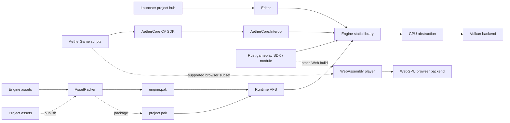

# Engine architecture and assets

[Back to the project overview](../../README.md) · [Building and releases](../building.md)

## Capabilities

| Area | Current capabilities |
|---|---|
| **Editor** | Standalone project Launcher, Night Amber ImGui workspace, dockable viewport and inspectors, scene hierarchy, project/file browser, UI canvas tools, theme editor, render-graph and texture inspection |
| **2D authoring** | Blank 2D projects, orthographic 2D viewport and XY tools, sprite placement and picking, non-destructive sheet slicing, sprite animation timelines, deterministic playback, and 2D asset publishing |
| **Rendering** | Bindless descriptors, buffer device address, render graph, GPU-driven draw culling, tiled lighting, directional and local shadows, GTAO, FXAA, tonemapping, post-processing, offscreen cameras |
| **Scene and simulation** | EnTT world, reflection-driven component editing and scene serialization, typed asset identities, Jolt 3D and Box2D 2D physics, skeletal animation, blending, root motion, day/night lighting |
| **Gameplay** | Public C# and Rust SDKs through a shared gameplay host; inspector-exposed C# fields, collectible assembly replacement outside Play, native interop and Visual Studio script debugging; Rust rebuild/relaunch |
| **Assets** | Virtual file system, glTF import, mesh and animation processing, texture transcoding, material presets and graph authoring, shared engine content, and target-qualified project packages |
| **Browser publishing** | Self-contained WebAssembly/WebGPU players for supported 2D and 3D profiles, cooked assets, packaged audio, browser saves, manifest integrity and explicit unsupported-content diagnostics |
| **Diagnostics** | Tracy CPU/GPU instrumentation, render-pass timings, resource inspection, validation logging, built-in editor-control MCP scene authoring, and Visual Studio debugger MCP workflow |

See the [shared gameplay ABI](gameplay-abi.md), [Rust gameplay guide](../rust-gameplay.md) and [Web export profiles](../web-export.md) for implementation details and target restrictions.

## Architecture



The frame pipeline follows an extract-and-consume model: the producer thread gathers render data into an immutable `RenderFramePacket`, then the render thread consumes that packet without reading mutable ECS state. See [Render-frame extraction](render-frame-extraction.md).

### Main native areas

| Path | Responsibility |
|---|---|
| `src/engine/gpu/` | Engine-facing device, command, handle, format, and synchronization abstractions |
| `src/engine/vulkan/` | Vulkan implementation, resource registry, swapchain, memory, descriptors, and diagnostics |
| `src/engine/rendering/` | Render graph, frame packets, queues, render thread, shadows, and pipeline state |
| `src/engine/scene/` | ECS world, scene subsystem, serialization-facing components, and hierarchy |
| `src/engine/assets/` | Asset database, glTF ingestion, model/texture creation, and upload services |
| `src/engine/material/` | Material authoring, registries, texture lifetime, and GPU material data |
| `src/engine/animation/` | Skeletons, clips, animation database, blending, and GPU skinning data |
| `src/engine/physics/` | Jolt integration and physics components |
| `src/app/scripting/` | Shared gameplay host, C#/Rust project integration, build and run coordination |
| `src/editor/debug/` | Editor panels, inspectors, project controls and shared editor chrome |
| `src/editor/launcher/` | Standalone Launcher process, project hub and Editor startup handoff |
| `src/editor/imgui/` | Dear ImGui backend and editor UI rendering integration |
| `src/app/web/` | Browser runtime, scene loading and gameplay integration |

Subsystems are wired through `ServiceContainer`. Engine startup and shutdown order is dependency-sensitive, and GPU-backed services are destroyed before the GPU device.

## Asset and shipping pipeline

AetherCore keeps engine and project payloads separate:

| Mount | Build artifact | Contents |
|---|---|---|
| `engine://` | `data/engine.pak` | Fonts, editor branding, compiled shaders, and other engine-owned runtime resources; staged once for the shared app bundle |
| `project://` | Project directory during development; `data/project.pak` when publishing | The opened project's scenes, prefabs, scripts, models, materials, textures, and derived assets |
| `shaders://` | Overlay over engine and project shader intermediates | Engine shaders plus project overrides during editor development |

`AssetPacker` processes project content before packing-texture transcoding, mesh/skeleton/animation extraction, material generation, shader optimization, and zstd compression, depending on source type. `engine.pak` is built once for the shared Editor/Launcher bundle; `project.pak` is created only when publishing.

```powershell
AssetPacker --project --import-materials projects/TestingProject build/data/project.pak
```

Material presets can be authored as TOML:

```toml
[material]
baseColorFactor = [1.0, 1.0, 1.0, 1.0]
metallicFactor = 0.0
roughnessFactor = 0.9

[textures]
albedo = "project://assets/textures/base-color.png"
normal = "project://assets/textures/normal.png"
metallicRoughness = "project://assets/textures/metal-roughness.png"
```

Asset references are catalogued through stable `AssetId` values, while texture and material registries remain the owning backends. See [Asset Database](../asset-database.md) for the design and reload roadmap.

## Repository map

```text
src/engine/                 Native engine library
src/app/                    Runtime shell, gameplay host, scene integration and browser runtime
src/editor/                 Native editor panels, authoring tools, Launcher and ImGui integration
src/shaders/                Slang shader sources
src/include/                Shared binary-format headers
managed/AetherCore/         Public C# gameplay SDK
managed/AetherCore.Interop/ Managed ABI and CoreCLR boot assembly
rust/aethercore/            Safe Rust gameplay SDK
projects/TestingProject/    Example editor project (scripts/AetherGame.csproj = game scripts)
projects/FoxShowcase/       3D example project (currently local work in progress)
website/                   Static product site and engineering articles
resources/                  Engine-owned config, fonts, branding, and templates
tools/assetpack/            Asset processing and PAK tooling
tests/                      Doctest-based test sources
docs/                       Architecture, asset, tooling, and design notes
```
