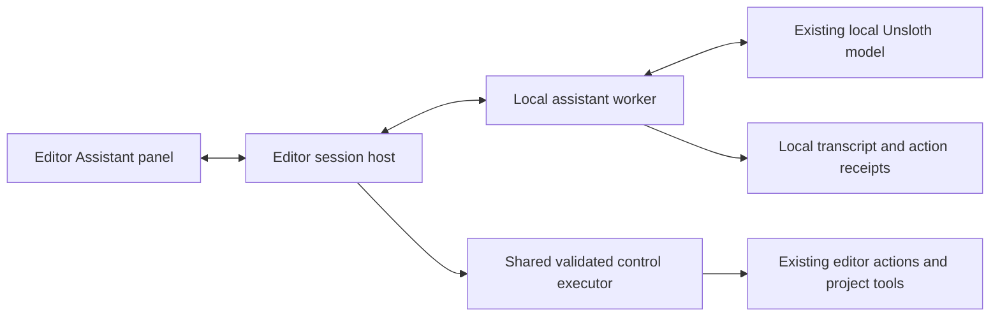

# Local editor assistant scope and design

Status: scope approved for implementation planning on 2026-10-21, including source
control and rollback before agent writes. See the [implementation plan](../plans/2026-10-21-local-editor-assistant.md).
Feature implementation has not started; measured Qwen performance is not promised.

## Intent and agreed direction

Build a dockable chat window inside AetherCore where a developer can create and
iterate on gameplay scripts, scenes and asset setup without leaving the editor.
Inference, history, project reads, tool execution and verification stay local.
The user already runs Qwen2.5-Coder-7B-Instruct alongside a game, using the Unsloth
app. Hardware feasibility is established by the user; model/agent reliability is
still to be measured. Provide a visible project/engine capability toggle, as
suggested by the user. Support rich, persistent conversations and observable edits.
The user also requires editor-integrated source control and rollback when an agent
makes unwanted changes; recovery must ship before agent mutation is enabled.

Use existing MCP/control operations, SDK declarations, reflection, graphs and
project jobs. Do not add a vector database, another graph, a cloud fallback or a
second collection of independently implemented editor actions.

## Three end-to-end examples

1. "The player is too slow": resolve the intended entity and movement field,
   display the old/new value, update the authored property, verify the result and
   let the user continue Play. During Play, explain the required restart; stop,
   re-resolve the authored entity after restore, apply the change and resume.
   Never claim that a temporary simulation edit has been saved.
2. "Use the knight model and make sprint accelerate": find an existing asset,
   change the visual while preserving the gameplay entity's components, patch the
   project script, compile, repair errors within the turn budget, and restart Play.
   Changes, tool progress and diagnostics are visible in chat. User-authored code
   that changed after the assistant read it produces a conflict rather than an
   overwrite. Creating models from text is a separate generation capability.
3. Edge case: Unsloth disconnects, the user changes projects, or a script fails
   compilation. Keep the transcript and completed action receipts; cancel owned
   pending work; do not apply late actions to another project, rerun an uncertain
   mutation automatically, or enter Play with a failed build. Report what actually
   changed and provide the applicable restoration controls.

## Current implementation: reuse and gaps

| Concern | Existing primitive | Work required |
|---|---|---|
| Dockable panel | [DebugPanel](../../../src/editor/debug/DebugPanel.hpp), registration in [DebugLayer](../../../src/app/layers/DebugLayer.cpp) | Assistant panel, composer and structured rich transcript |
| Editor operations | [ControlMethod](../../../src/editor/editor/ControlMethods.hpp), schemas and handlers | Shared validated executor usable without an ENet listener; task-relevant tool selection |
| Thread boundary | [ControlServer](../../../src/editor/editor/ControlServer.cpp) queues and drains requests on the game thread | Preserve validation and main-thread mutation for the embedded caller |
| Project identity | [EditorProjectContext](../../../src/editor/editor/EditorProjectContext.hpp) | Stamp every turn/action with project and generation; reject stale results |
| Script operations | [ControlMethods2D](../../../src/editor/editor/ControlMethods2D.cpp) attaches/lists/removes scripts | Typed script-property update; add-script is not an update operation |
| Script field writers | [ComponentDrawersScripts](../../../src/editor/debug/ComponentDrawersScripts.cpp) | Extract/reuse non-UI property mutation and typed undo |
| Scene undo | [UndoStack](../../../src/editor/editor/UndoStack.hpp), typed commands and groups | Short action-scoped groups; do not keep a group open during inference |
| Source edits | Existing file utilities and project paths | Bounded file read/search/patch; atomic writes, hash preconditions and checkpoint-linked restoration receipts |
| Source control | Repository uses Git; no first-party editor integration found | Native Git panel, deliberate commits, history/diffs and protected pre-turn recovery points |
| Build/run/test | [Gameplay jobs](../../../tools/project/gameplay_jobs.py), [pipeline](../../architecture/gameplay-abi.md#agent-gameplay-pipeline) | Integrate job events/results into the conversation; own cancellation |
| SDK knowledge | [API and example guide](../../getting-started.md#script-apis-and-examples) | Bounded source lookup and context assembly using those entry points |
| Settings | [EngineSettings](../../../src/engine/utils/EngineSettings.hpp), SettingsService | User-only endpoint/model/budget preferences; classify them in SettingsHomeFor |
| Model streaming/history | No corresponding editor feature found | Local streaming worker, conversation store, cancellation and crash recovery |

Important source finding: [ScriptedSceneLayer::OnUpdate](../../../src/app/layers/ScriptedSceneLayer.cpp)
explicitly refuses C# reload while Play is active. [PlaySession](../../../src/app/PlaySession.cpp)
captures authored scene state and restores it on Stop. Current README/getting-started
claims about mid-Play F5 reload are stale and must be corrected with the feature work.
C# edit-mode reload also has a synchronous path, so the assistant must use or extend
the existing asynchronous compile/Play path rather than block the UI with it.

## Proposed architecture (engineering recommendation)

Keep inference in the user's existing Unsloth process. Add one editor-owned local
Python worker for HTTP streaming and conversation orchestration, using the stdlib
and the project's existing Python tooling conventions. This adds no second model
instance. A small native session host validates and dispatches requested actions;
the ImGui panel only renders events and sends user commands.

New feature code belongs to editor tooling, with prospective native files under
`src/editor/assistant/` and worker code under `tools/assistant/`. It must not enter
Engine, Launcher, GameRuntime or the public gameplay SDK. Extend process transport
with a cancellable duplex stdio channel: today's Process API captures/logs whole
processes and is not already a persistent streaming worker interface.

Extract the existing control validation/dispatch into an executor shared by the
ENet endpoint and assistant. Drain queued actions on the game thread even when the
external control endpoint is off. Do not call raw handlers from inference threads.
The embedded caller is bound directly to its owning editor/project, avoiding default
port 8787 and accidental control of another open editor. Existing external MCP
clients retain their schemas, behaviour and main-thread execution.

Register narrow missing project-authoring operations beside the existing control
catalogue; derive schemas from one definition. Engine-source writing is a capability
of the editor assistant session, not a new unrestricted external wire endpoint.
Worker requests are untrusted proposals: the native host checks scope, project,
file preconditions and tool parameters before performing any action.

Only one assistant turn may mutate overlapping canonical project/engine roots
across editor processes. Acquire cross-process ownership before checkpoint capture;
engine-mode turns include both roots, with deterministic lock ordering. Hold ownership
through the mutating turn or restoration and release on completion/cancellation/crash;
report contention rather than allowing competing writes. Recheck versions after
acquiring ownership. Model-generated tool calls execute serially. The user can
continue ordinary editor work; a changed target invalidates conflicting assistant
actions. This ownership is not an open scene-undo group. Stop cancels generation and not-yet-applied actions;
completed changes remain listed. Closing the panel hides it; closing the editor or
switching projects cancels/joins owned work. Never terminate the user's Unsloth app.

## Local model connection

Use Unsloth's OpenAI-compatible `POST /v1/chat/completions` with streaming and
client-side tool calls. Configure the actual loopback endpoint, model ID and local
API credential; discover model IDs through `GET /v1/models` when supported.
Unsloth documents streaming, authentication and tool calling, but older releases
lack the API. Verify the installed app/model before implementing against it.
[Official Unsloth endpoint documentation](https://unsloth.ai/docs/basics/api).

First connection tests text streaming, complete tool-call assembly, one safe tool
round trip, cancellation and disconnection. A partial tool call never executes.
Disable Unsloth's server-side web/code tools: AetherCore owns tool execution and
locality. Do not enable web search, tunnels or cloud model fallback. If the exact
Qwen/template/quantization cannot reliably emit usable calls, report that failure
and evaluate it; do not silently execute commands parsed from ordinary prose.

Use masked session credentials or an environment-supplied secret, never project
settings, command-line arguments, transcripts or logs. Endpoint/model/budget values
are user settings; mark their keys User in SettingsHomeFor so they do not ship.
The first development release may require an installed/configured Python runtime;
validate it from the panel. A bundled-worker-runtime distribution must be qualified
before advertising a self-contained editor installation.

## Chat experience and persistent history

Provide a dockable Assistant panel with streaming responses, a multiline composer,
Stop, new/open conversation, local model/connection status and the project/engine
scope indicator. Include the selected entity/scene as visible context chips.

Rich history contains text, code blocks, source links, before/after diffs, tool
progress/results, build/test diagnostics and image attachments. Use structured ImGui
blocks consistent with the existing UI; arbitrary HTML or a browser app is not
required. Screenshot attachments are useful to the developer. Qwen2.5-Coder is a
text model: screenshots must not be treated as visual evidence understood by it.

Store versioned conversation event logs and attachments/change receipts under
`<project>/.aether/assistant/`, with a matching gitignore rule. Use one write owner,
ordered event IDs, recoverable append records and explicit session/turn/action IDs.
Keep exact requests/results and artifact paths locally; large outputs are stored as
attachments and summarized for the model. Missing/deleted artifacts display as such.
Reopening a conversation restores history, not tool execution or old runtime IDs.

Persist intended actions before mutation and completion receipts afterwards. If a
crash occurs between them, reconcile against observed state and label uncertainty;
never automatically repeat an action whose effects are unknown. Summaries are
rebuildable from the log. Deleting/exporting conversations is an explicit user action.
History and recovery payloads remain excluded from game packaging as well as ordinary
project version control. Recovery records are protected local editor state, not files
that the model can patch or remove through its project/engine tools.

## Context and agent loop

For each turn, gather project language/target, current scene and selection, relevant
messages, a compact working summary, current source snippets and recent diagnostics.
Use the SDK/example navigation already added, filesystem search and available graph
queries. Graph tools may be absent on another developer's machine; direct source
lookup remains sufficient. No graph rebuild or embedding service is required to chat.

Expose small relevant groups from the existing tool catalogue rather than its entire
manifest every turn. The host retains authority to reject unavailable or disallowed
operations. Bound source reads, tool outputs, prompt size, tool count, repair attempts
and total turn duration. Preserve whole tool-call/result pairs when pruning context.
Refresh stale source and entity identities after reload or project/scene changes.

The loop is inspect -> retrieve -> propose action -> validate/apply -> observe ->
build/test when relevant -> repair within budget -> report. Show progress from real
host/job events. Claim a build or test succeeded only from its terminal report.
Ask for clarification when a target remains ambiguous; do not guess between several
similarly named players or assets.

## Editing, Play and restoration semantics

Default assistant changes affect authored project state. During Play, the first
release uses stop -> re-resolve restored authored targets -> edit -> asynchronous
compile -> resume Play. This resets the simulation; say so before it happens.
Changes to a script's public defaults do not override existing serialized fields;
update the actual entity's typed authored property when that is what the request means.

A later live-preview milestone can adjust supported runtime fields immediately,
marked as temporary. Keeping a preview stops Play and reapplies the verified patch to
authored state. Creating a typed field setter does not by itself make live values
persistent. Arbitrary script-state-preserving hot reload is a separate engine project.

Use the existing typed undo commands for supported scene edits. New file operations
record before/after content and hashes, write atomically, and offer conflict-aware
restoration. Binary assets are selected/imported through existing asset operations;
text patching is not a general binary editor. Do not overwrite a dirty scene/material
from disk while its editor document is authoritative.

A chat turn spanning files, scenes and builds is not one atomic transaction. Show
per-action outcomes and restoration availability; compensate completed reversible
steps when possible. Never promise that Ctrl+Z restores files, generated builds,
simulation state, save writes or arbitrary script side effects. Do not undo unrelated
human edits made while the assistant was thinking. Resolve paths canonically and
reject traversal/symlink escapes outside the session's allowed roots.

## Integrated source control and agent recovery

This is required product scope, and a prerequisite for enabling assistant writes.
Use Git for normal source-control history and the already-planned action receipts
for local recovery checkpoints. Do not invent a replacement version-control system
or duplicate file backups in an unrelated store. A Git commit alone is not the
complete checkpoint: it cannot represent an unsaved in-memory editor document.

### Native Source Control panel

Use the existing process/argv primitives to drive installed Git locally, without
adding libgit2 initially. The panel shows repository/branch, changed and untracked
files, text diffs, binary-change metadata, staging, explicit commits and commit
history. It also exposes checkpoint comparison and restoration. It must work
without a model connected. Create/switch branches through explicit user actions,
with dirty-work/conflict checks and existing editor unsaved-work handling.

Discover the actual repository root for each project and the engine checkout.
A project nested in the AetherCore monorepo may share the engine repository; show
that clearly and scope file operations correctly. Do not silently initialize nested
repositories. For a project without Git, offer user-directed local repository setup.
If Git is missing, report the prerequisite; do not silently download it. Assistant
writes require a healthy local repository and completed recovery readiness; until
explicit repository setup, chat and inspection remain available. Remote
sync/hosting is not required for recovery; any future push/pull remains a deliberate
user operation. No hooks or automatic CI are introduced.

Preserve existing staging and unrelated changes. Never stage the entire worktree
on the user's behalf. A commit acts on the staged content shown to the user.
Repository instructions continue to apply; selecting engine mode does not authorize
commits, branch changes or history rewriting. Automatic recovery capture uses local
checkpoint records and performs no Git mutation. The model can inspect source
control status/diffs and propose a restore, but cannot directly reset history,
force-push, clean the worktree, delete checkpoints or invoke arbitrary Git commands.

### Before every modifying assistant turn

Create a durable recovery point before the first write. Include current on-disk
contents/existence for every affected path, original staged/unstaged status metadata,
and recoverable authored state for any dirty scene/material/other editor document
the turn will touch. Include new/untracked authored files and binary assets when
relevant. Existing in-memory values and on-disk values are distinct: capture both
without silently saving the user's dirty document over its file.

The existing DebugPanel save/dirty interface and AutosaveService do not already
provide generalized in-memory document snapshots. Add narrow recovery adapters for
supported document types; if a document type cannot be captured and restored,
block assistant mutation of that document. The checkpoint captures authored state,
not a running game's physics, heap or arbitrary external script side effects.

Capture a turn baseline and add preimages before touching paths discovered later.
As a turn proceeds, associate each mutation's before/after receipt with that one
baseline. Recheck target versions after capture. A newly discovered file without a
preimage must be captured before its write. If capture fails or storage is full,
stop before changing that target and leave the assistant able to inspect/explain.
Publish the checkpoint ID in the transcript; completed tests may mark an outcome
verified, but a passing build does not make a change semantically correct.

### Restore and timeline

Each modifying chat turn provides **Changes**, **Restore this turn**, and its
verification status. The independent Source Control panel provides checkpoint
history and **Undo assistant changes since here**. The user can pin a known-good
point. These are action checkpoints: they retain preimages for affected paths and
documents, not complete whole-project images captured at one instant. Paths discovered
later use their actual pre-write state, including intervening human edits. Do not
label this operation as a full project snapshot restore. Normal Git history separately
supports user-directed comparison/restoration of committed file versions.
Ordinary scene Ctrl+Z remains available for typed scene edits.

Restore-this-turn uses the recorded delta and content preconditions to preserve
pre-existing work and subsequent human changes. If a later edit overlaps, show the
conflict rather than guessing or overwriting. Undo-assistant-changes-since-here
walks the recorded action deltas back to the selected boundary, preserving unrelated
changes; overlapping subsequent user edits require resolution. Preview all affected
files/documents. Take another recovery point before applying either restore. Restore newly
created/deleted/renamed/binary files by recorded identity and scope, without deleting
unrelated files created later. Stop Play and outstanding mutating jobs first, then
coordinate document reload, asset refresh and script rebuild so memory and disk
agree. Retain the transcript and record the restore as a new event.

Do not silently change the normal Git index, branch or HEAD during checkpoint
restoration. Detect external repository/index changes and reconcile the displayed
state; checkpoint recovery is not permission to undo another tool's Git operation.

Project and engine changes use the same recovery concepts, with explicit roots.
An engine checkpoint restores source; switching a running editor back to its last
working build uses the engine-mode handoff path. Code rollback is not restoration
of arbitrary game save writes, network activity or other runtime side effects.

### Persistence and qualification

Store checkpoint payloads once with the existing conversation/action state and
reference them from the source-control panel; named recovery points must remain
usable if their conversation is removed. User history deletion cannot silently
remove a pinned or still-needed recovery point. Keep active-turn preimages and
pre-restore recovery points durable through crashes. Model tools cannot address
`.git` or recovery storage, including indirectly through broad directory operations.

Expose storage use and a user-controlled retention policy. Never evict active or
pinned recovery points to make a write succeed. Large asset replacement must either
have a complete preimage or be refused; Git LFS/paid hosting is not assumed. Local
checkpoint protection targets accidental unwanted edits, not malicious code running
with the user's OS permissions or disk failure.

Qualify dirty worktrees, partially staged files, untracked assets, unsaved scenes,
binary replacements, create/delete/rename, overlapping later edits, external Git
changes, multiple editor windows, disk-full/capture failure, interrupted restore,
conversation deletion and engine candidate failure. Reopening the editor must allow
recovery without first contacting or trusting the model. Existing scene recovery
and the user-owned Git workflow must continue to work independently.

## Project/engine toggle

Project mode is the default. It writes only the open project's authored files and
uses its scene/asset/script tools. It can read the SDK and relevant engine docs.
Engine mode adds source access for an explicitly configured AetherCore checkout,
engine code changes and supported local CMake build/check operations. Display the
mode in the composer, each action and history. It is session-scoped and returns to
Project mode on project switch/restart. A model message cannot enable it. Reject
engine actions still queued if the toggle is turned off.

Engine mode is available only in a source-development setup with valid build inputs;
an installed editor without sources explains the limitation. Keep changes in
first-party source/config/test files. Preserve the repository rules for generated
files, third-party/build directories, init/shutdown dependencies and manual-only CI.
No automatic Git mutations or remote operations: those require an explicit user
request or direct Source Control panel action, independently of the toggle. Normal project iteration needs no repeated
approval for each reversible action within the selected scope.

Build a candidate editor into an isolated output directory through the existing
CMake configuration; do not relink the currently running Windows executable. Run
appropriate local checks before offering to switch. The user initiates the restart
from a clear action in chat; first handle unsaved-work prompts and persist history.
An owned helper outside the editor performs the handoff, opens the same project and
conversation in the candidate, and retains the old working executable/build for
fallback. Candidate launch failure is a failed handoff, not a successful engine
update. Validate cancellation, ownership, readiness and fallback before shipping.
Engine C++ replacement requires an editor restart; the scope does not promise live
replacement of the running executable or GPU systems.

## Delivery phases and acceptance gates

| Phase | Deliverable | Gate before proceeding |
|---|---|---|
| 0. Model/API proof | Verify this installed Unsloth app, exact Qwen model, auth, streaming and a client-side tool round trip; record untuned baseline | All local; malformed/partial calls never execute; measured tool behaviour |
| 1. Chat foundation | Dockable panel, worker lifecycle, streaming, Stop, settings and durable rich history | UI remains responsive; restart restores history; disconnect/project-switch/close tests pass |
| 2. Grounded inspection | Current selection/project state, SDK/example reads and bounded tool discovery | Real API answers point to current source; no dependence on another graph service |
| 3. Source control and recovery | Native Git status/diffs/staging/commits/history plus protected pre-turn checkpoints and restoration | Dirty/staged/untracked/unsaved state survives failed turns, crash and restore; mutation stays off until protection works |
| 4. Project authoring | Typed script-field update, file patches, scene/asset edits, typed undo and checkpoint-linked receipts | Slow-player/model-swap scenarios persist through Stop/save/reopen; stale content is protected; each turn is recoverable |
| 5. Compile and iterate | Async build, diagnostics, bounded repair, tests and stop/edit/resume in chat | Fresh script creation/attachment and compile-failure repair work for C# and Rust; failed builds never Play |
| 6. Live preview | Supported transient field edits and explicit keep-to-authored behaviour | Preview-only values and kept changes behave correctly across Stop/reload |
| 7. Engine mode | Capability toggle, source patch/check, isolated candidate build, owned restart/handoff/fallback | Engine writes denied in Project mode; failed build/launch preserves recovery; resumes conversation |
| 8. Qualification/distribution | Offline install/runtime prerequisites, portability, cancellation/crash/recovery and interaction measurements | Real local model + editor tests pass; report Windows/Linux results separately; manual gauntlets only |
| 9. Specialization experiment | Curated local interaction dataset, Unsloth adapter training and held-out comparison | Fine-tuned model improves measured tasks over untuned model with identical context/tools |

Phases are dependency order, not time estimates. Phase 3 is mandatory before agent
writes. Phase 5 is the first complete project-authoring release; phases 6-7 complete
the additional preview/engine scope.
Engine mode and training are included explicitly rather than assumed to come free
with a chat window. Building a self-contained installer is a separate qualification
from connecting to a model already running on the developer's machine.

## Fine-tuning track

Start with the untuned named model; the assistant must work before training. Curate
requests, actual API context, tool calls, errors, repairs and verified final outcomes
from local sessions. Include unsupported requests and cases requiring clarification.
Do not train blindly on all chat logs, test failure hooks, obsolete APIs or raw repo
files. Exclude credentials and unrelated personal data from exported examples.

Version examples by engine revision, SDK language/target and tool schema. Separate
held-out tasks by behaviour/task family, not just random near-duplicate snippets.
Use Unsloth for a reproducible adapter experiment on Qwen2.5-Coder-7B-Instruct; choose
training parameters after inspecting the available setup. Training is an explicit
separate local job, not something that silently competes with the running editor.

Compare untuned and tuned models using the same runner, quantization, context,
tools, budgets and representative unseen requests. Measure tool-call validity,
correct targets, task success, compile/test success, repair count, time/tokens and
human corrections. Include new combinations and API changes. Adopt the adapter only
on demonstrated improvement, and retain an easy return to the untuned model.

## Validation and remaining decisions

Use protocol/session tests with split streaming chunks, malformed/duplicate calls,
context overflow, unavailable tools, auth failure, disconnect and cancellation.
Test real scene/file changes, conflicts, typed undo and restoration, reload ID
changes, dirty editor documents, interrupted history and cross-project isolation.
Run integration against the user's real Unsloth model and real editor, followed by
appropriate local gauntlets; mocks alone do not qualify the feature. No automatic
workflow or hook is added.

The exact installed Unsloth version, endpoint, model ID and tool-template behaviour
remain implementation-time capability checks; app-level API support is documented,
not verified on this machine during this scoping pass. The project/engine toggle is
user direction; its default-off behaviour, staged rollout and restart action are
engineering recommendations for review. Native UI styling and test-budget constants
are builder choices within the existing editor conventions. No code, dependency,
model installation, build, git mutation or external publication is part of this
scoping task.
